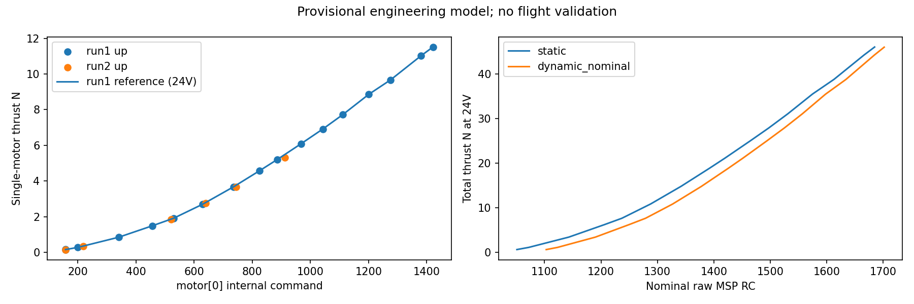

# motor[0] 实测工程初版（2026-10-29）

状态：provisional；飞行验证：not_performed。原日志只读；单电机乘4是假设，目标RC域是名义转换。

Vref=24.0 V；p=1.253471255（可配置，不表示同等物理精度）。
第一组上扫保留 17 个稳态窗口，形成 16 个不同motor点。
相同motor均值的重复窗口选最长核心；缺口两侧窗口均保留在steady_windows.csv。
第一组下扫用于选p：3 点，平均/最大相对差 0.278% / 0.419%。这不是独立验收。
第二组上扫辅助：4 点，平均/最大相对差 1.747% / 3.482%。
同样辅助点改去皮142gf：平均/最大相对差 14.028% / 22.647%。

第一组去皮147gf；第二组前/中段196gf；第二组下降尾段排除主拟合，不拟合人为零漂。
安静段复算中位数：run1开始147/结束146gf，run2开始196/结束142gf。
每0.1s分箱，motor中位数跨度≤4，原段≥1.2s（容许两个1kHz采样间隔的边界误差）；去前0.3/后0.2s。
从每个bin边界寻找最长稳定区间、优先选互不重叠长窗口，避免起始settling bin导致整段后缀丢失。
统计核心内原生force样本均值/标准差/半段差；不把100Hz消息当成100Hz独立ADC样本。
第一组约30ms缺口所在bin排除，窗口不跨缺口；ULog早期dropout不落在所选窗口。
用motor稳态选窗，未按推力误差挑点。与提示词探索数值的差别来自分箱/窗口边界及最小二乘选p目标。

p候选（第一组下扫，净力≥50gf）：

| p | 平均相对差 | 最大相对差 |
|---|---:|---:|
| 0.000000 | 4.487% | 4.885% |
| 1.000000 | 0.892% | 1.306% |
| 2.000000 | 2.579% | 2.984% |
| 1.253471 | 0.278% | 0.419% |

motor有效域 [158.0, 1421.439299123905]；所选 dynamic_nominal；RC域 [1103, 1702]。
static对照RC域 [1051, 1685]，dynamic_nominal域 [1103, 1702]。
24.0V整机推力域 [0.6383320472662378, 45.97391777551542] N；仅在motor实测支持域内按整数RC采样。
m=530时，static约RC1237.1，dynamic_nominal约RC1279.1；未将旧RC→motor回归写回模型。
目标dyn_idle_min_rpm=40；参数值及来源见target_fc_mapping.yaml；历史profile和默认参数均不是当前FC回读。
动态怠速delta≈0、零PID力矩、线性油门及无FC电压补偿等条件见target_fc_mapping.yaml；没有回读或改写飞控。

原日志电压域：{'1': [21.84, 24.66], '2': [20.82, 23.66]}；主拟合稳态电压域：[22.9, 24.63] V。
允许模型电压域：[21.0, 24.66] V，是有限工程近似域；低端没有充分稳态验证，20.82V瞬态不纳入。
Tmax(V)=Tmax_ref*(V/Vref)^p；21.0V时 38.888418 N。
当前MPC每电机等效上限 7.84 N（整机上限为该值乘4），未改控制器限幅。
该限幅检查仅是名义零力矩总推力裕量，不保证实际PID分配/动态怠速下的电机裕量。

对齐使用a=1和给定候选b；早中晚阶跃的局部残差：run1约-10..60ms，run2约5..45ms。
这是响应对齐，不是硬件时钟同步。保留固定偏移，300ms前裁剪覆盖这些残差。
偏移±80ms敏感性：[{'offset_perturbation_s': -0.08, 'p_fitted': 1.2552109057510132}, {'offset_perturbation_s': 0.08, 'p_fitted': 1.2590629432381366}]。

运行链：Tlookup=Tdesired*(Vref/V)^p → 单调表反解；仅导出RC表时乘4，运行时不乘质量/4，不缩放body_rates。
额外电压滤波τ=0，max_age=1.5s沿用hardware evidence.battery_timeout，按真实MSP报告身份/原请求时间计龄。
0N返回既有输出层idle语义（不承诺实测0N）；正低端返回最低支持RC并置lower_saturated；超上限/电压越域/过期拒绝。
Python和C++均允许本provisional实测motor名义转换文件，thrust_calibrated仍为false，thrust_mapping_ready仅表示成功加载。
原授权/解锁/健康/接管/shadow门禁保留。未执行实机输出、写参、部署或飞行试验。

复现与选用命令见 ../../tools/thrust_calibration/MOTOR0_TRIAL_README.zh-CN.md。
